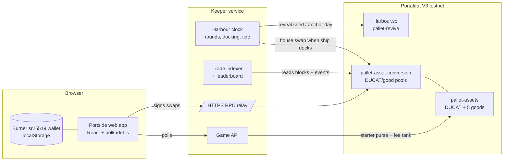

# Portside

**A harbour trading game where every price is a live pool on Portaldot's native DEX.**

You run a merchant's warehouse in a busy port. Ships bring in five goods: Coffee, Spice, Silk, Salt and Copper. Every five minutes the harbour board announces news, such as a storm, a shipwreck or a bumper harvest. Read it, trade before the ship docks and moves the market, and finish the day with the highest net worth.

Built for the Portaldot Hacker House 2026 (Ecosystem DApps track).

## Why it's built this way

| Portaldot V3 feature | How Portside uses it |
|---|---|
| `pallet-assets` | DUCAT and the five goods are native assets |
| `pallet-asset-conversion` (native DEX) | Each good trades in a DUCAT/good pool, so player trades move the real price |
| Fee sponsorship | The harbour gives every new captain a small tPOT tank and tops it up, so players never go looking for gas |
| `pallet-revive` (EVM) | The `Harbour` contract draws each round's event with commit-reveal and anchors daily standings |
| Dual VM | Game logic lives where it's cheapest: markets on the Substrate side, the neutral referee on the EVM side |

Every trade, event draw and price move is a real testnet transaction.

## Architecture



### A round
1. **Reveal.** The keeper reveals the seed it committed last round. `Harbour.reveal` mixes it with the previous block hash, so neither the keeper nor the players can pick or predict the event. The contract emits `RoundOpened(good, kind, magnitude)`.
2. **Read the board.** Players see "SHIPWRECK · COPPER ▲ 29%" and have 45 seconds to trade before the ship docks.
3. **Dock.** The keeper makes one house swap that moves the pool's spot price by exactly the announced amount. On a constant-product pool the DUCAT side scales by √factor.
4. **Tide.** Halfway through the round every market drifts a quarter of the way back to its base price, which keeps the economy bounded.
5. **Day end.** Standings are hashed into a Merkle root and anchored with `Harbour.anchorDay`.

## Repo layout

```
contracts/  Harbour.sol + Hardhat tests (6 passing)
keeper/     harbour clock, setup script, trade indexer, game API (Hono)
web/        the game (Vite + React), with ?mock for offline design work
fork/       Chopsticks fork of the V3 testnet for local development
```

## Run it

```bash
npm install
```

**Local fork** (real runtime, fake balances, no testnet tokens needed):

```bash
./fork/start.sh                       # ws://127.0.0.1:8000
cd keeper && npm run setup            # creates DUCAT, goods, pools
ROUND_SECONDS=120 npm start           # keeper on :8790
cd ../web && npm run dev              # game on :5173
```

**Testnet**:

```bash
cd contracts && KEEPER_EVM_KEY=0x… npm run deploy
cd ../keeper && CHAIN_WS=wss://test-node-v3.portaldot.dev CHAIN_HTTP=https://test-node-v3.portaldot.dev \
  HARBOUR_ADDRESS=0x… KEEPER_EVM_KEY=0x… FEE_MODE=native npm run setup && npm start
```

The keeper serves the built web app too (`npm run build` in `web/`), so one service runs everything.

## Notes from building on V3
- The public `wss://` endpoint drops large frames, such as metadata. The keeper relays JSON-RPC over HTTPS, and the browser talks to the chain through it.
- Native tPOT has 14 decimals. Game assets use 10.
- Contract storage costs 0.06 tPOT per byte on pallet-revive, so `Harbour` is 1.7 KB and holds only what needs a neutral referee.
- Chopsticks needs `allow-unresolved-imports` because the runtime imports statement-store host functions.
- Paying fees in a pool asset through `ChargeAssetTxPayment` panics the V3 runtime during transaction validation (`wasm unreachable` in `TaggedTransactionQueue_validate_transaction`), on the live testnet as well as on the fork. Portside therefore runs with `FEE_MODE=native`: the keeper sponsors a 0.3 tPOT tank per captain and refills it. Switching back to DUCAT fees is one env var once the runtime is fixed.
- A player swap costs about 0.019 tPOT in fees. A `Harbour.reveal` costs about 0.019 tPOT after the first one, which also pays a one-off storage deposit (about 3.9 tPOT). Deploying the 1.7 KB contract cost about 148 tPOT, almost all of it storage deposit.

## Testnet deployment

Live game: **https://portside.nerom.site**, running against the Portaldot V3 testnet (explorer: https://node-console.portaldot.dev/).

| What | Where |
|---|---|
| `Harbour` contract (pallet-revive) | `0x04570accAB9f6fa3637aE0bBbEDfB9D46440D297` |
| Contract deploy tx | `0xb755f84e9b4fda98b008aa5064b51e7d13649c31d5bc053458be56e6d06e1ad3` (block 277,716) |
| Keeper (Substrate) | `5E7ozxL2HiPecUiSADdwPDLcnowq7QqUcLoLurpyuXVWpu7G` |
| Keeper (EVM) | `0x586992529e9612533a4EfbAF22e65341Ea5E6c44` |
| Assets | DUCAT `8801000`, Coffee `8801001`, Spice `8801002`, Silk `8801003`, Salt `8801004`, Copper `8801005` |
| Pools | tPOT/DUCAT plus DUCAT/Coffee, DUCAT/Spice, DUCAT/Silk, DUCAT/Salt, DUCAT/Copper on `pallet-asset-conversion` |

Transactions from the first play-test on the testnet (Nov 1 2026):

| Step | Hash |
|---|---|
| `Harbour.reveal`, season 1 round 2 (Shipwreck, Silk +9%) | `0xb9b0a241874a5373d8fd8a09397dbf2c03b3eed72b5a68ab0d84091f1f40b1ff` |
| House swap when that ship docked (Silk 55.00 → 59.96) | `0x57779da87fee8f91719bc97f2adfd049c11d58d248a29e3b2246b1bf0d40df8a` |
| Captain registered: starter purse and fee tank | `0xb37eb52c330c60a29318a9865f9e836257ac06d50ce285d6edbd99f3a6e747ac` |
| Captain's swap from the browser, 100 DUCAT → 8.28 Coffee (block 277,781) | `0x4fe4cd7e4643380a4eeb95eef2dfa7428f008addf3742d1e9906c7981af3ca99` |
| Swap by a fresh account paying its own fee in tPOT | `0xe3d5ede565e641bcb6ea04f2b81d6b0780893c382a2aab96613aec364a86c304` |
