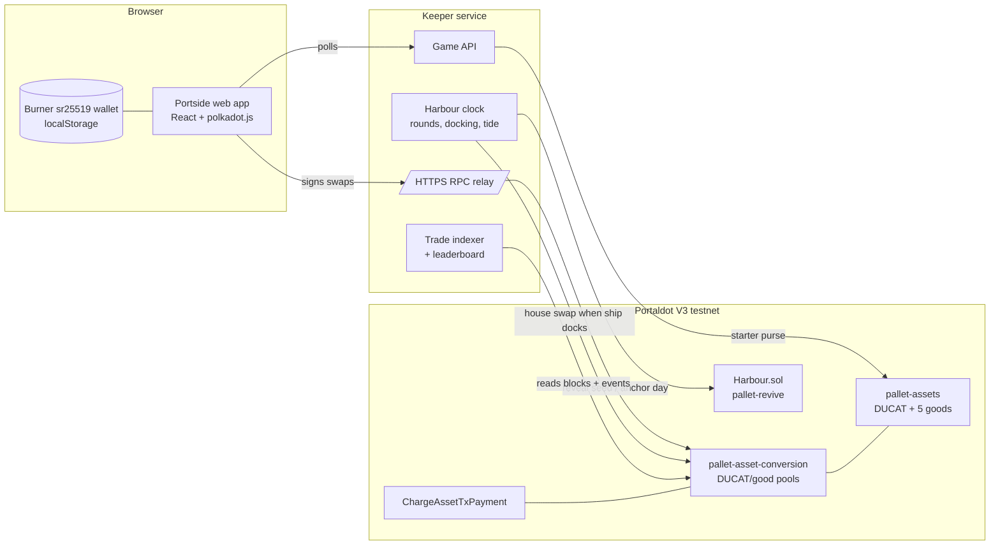

# Portside

**A harbour trading game where every price is a live pool on Portaldot's native DEX.**

You run a merchant's warehouse in a busy port. Ships bring in five goods: Coffee, Spice, Silk, Salt and Copper. Every ten minutes the harbour board announces news, such as a storm, a shipwreck or a bumper harvest. Read it, trade before the ship docks and moves the market, and finish the day with the highest net worth.

Built for the Portaldot Hacker House 2026 (Ecosystem DApps track).

## Why it's built this way

| Portaldot V3 feature | How Portside uses it |
|---|---|
| `pallet-assets` | DUCAT and the five goods are native assets |
| `pallet-asset-conversion` (native DEX) | Each good trades in a DUCAT/good pool, so player trades move the real price |
| `ChargeAssetTxPayment` | Players pay network fees in DUCAT and never need tPOT for gas |
| `pallet-revive` (EVM) | The `Harbour` contract draws each round's event with commit-reveal and anchors daily standings |
| Dual VM | Game logic lives where it's cheapest: markets on the Substrate side, the neutral referee on the EVM side |

Every trade, event draw and price move is a real testnet transaction.

## Architecture



### A round
1. **Reveal.** The keeper reveals the seed it committed last round. `Harbour.reveal` mixes it with the previous block hash, so neither the keeper nor the players can pick or predict the event. The contract emits `RoundOpened(good, kind, magnitude)`.
2. **Read the board.** Players see "SHIPWRECK · COPPER ▲ 29%" and have 45 seconds to trade.
3. **Dock.** The keeper makes one house swap that moves the pool's spot price by exactly the announced amount. On a constant-product pool the DUCAT side scales by √factor.
4. **Tide.** Halfway through the round every market drifts a quarter of the way back to its base price, which keeps the economy bounded.
5. **Day end.** Standings are hashed into a Merkle root and anchored with `Harbour.anchorDay`.

## Repo layout

```
contracts/  Harbour.sol + Hardhat tests (6 passing)
keeper/     harbour clock, setup script, trade indexer, game API (Hono)
web/        the game (Vite + React), with ?mock for offline design work
fork/       Chopsticks fork of the V3 testnet for local development
```

## Run it

```bash
npm install
```

**Local fork** (real runtime, fake balances, no testnet tokens needed):

```bash
./fork/start.sh                       # ws://127.0.0.1:8000
cd keeper && npm run setup            # creates DUCAT, goods, pools
ROUND_SECONDS=120 npm start           # keeper on :8790
cd ../web && npm run dev              # game on :5173
```

**Testnet**:

```bash
cd contracts && KEEPER_EVM_KEY=0x… npm run deploy
cd ../keeper && CHAIN_WS=wss://test-node-v3.portaldot.dev CHAIN_HTTP=https://test-node-v3.portaldot.dev \
  HARBOUR_ADDRESS=0x… KEEPER_EVM_KEY=0x… npm run setup && npm start
```

The keeper serves the built web app too (`npm run build` in `web/`), so one service runs everything.

## Notes from building on V3
- The public `wss://` endpoint drops large frames, such as metadata. The keeper relays JSON-RPC over HTTPS, and the browser talks to the chain through it.
- Native tPOT has 14 decimals. Game assets use 10.
- Contract storage costs 0.06 tPOT per byte on pallet-revive, so `Harbour` is 1.7 KB and holds only what needs a neutral referee.
- Chopsticks needs `allow-unresolved-imports` because the runtime imports statement-store host functions.

## Testnet deployment
_Contract address, transaction hashes and explorer links will go here once deployed._
